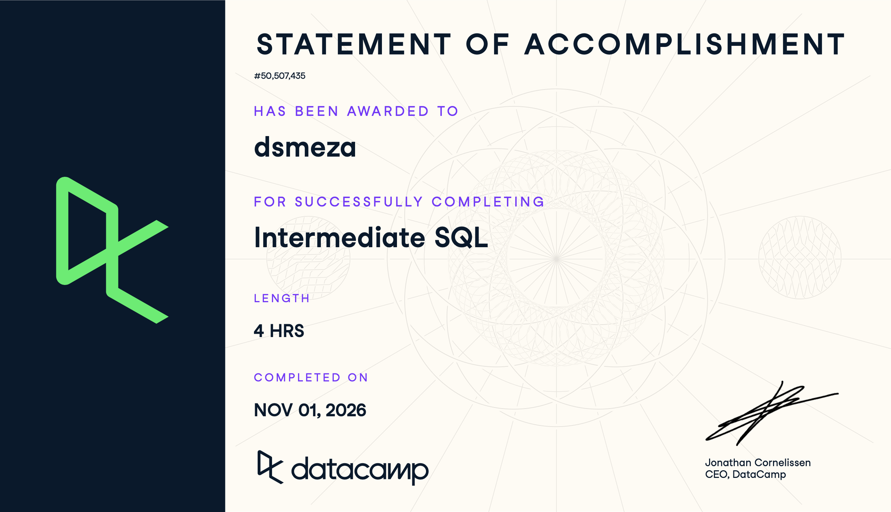

# Course-Completion Evidence

{width="657"}

I completed the **Intermediate SQL** course in the IBM 6500 DataCamp classroom on October 31, 2026. The certificate above shows my name and the course title.

# Learning Notes and Key Takeaways

The course uses a films database in PostgreSQL. To make my notes reusable for the CEP, my examples use made-up marketing tables:

- `orders` (order_id, customer_id, channel, order_date, order_total)
- `customers` (customer_id, email, signup_date)
- `web_pages` (page_path, source, sessions)
- `campaigns` (campaign_name, clicks, revenue, ad_spend)

These are placeholders I invented for practice. They contain no real client data.

## Chapter 1: Selecting Data

### Counting rows and unique values

**Main ideas:** `COUNT(*)` counts every row, while `COUNT(DISTINCT column)` counts each different value once. The difference tells me whether a table has repeated entries, such as a customer who placed several orders.

**Important SQL syntax:** `SELECT`, `FROM`, `COUNT(*)`, `COUNT(column)`, `DISTINCT`, `AS`.

**When to use it:** to find out how big a table is and how many unique people, products, or pages it holds before I analyze it.

**SQL example:**

``` sql
SELECT
    COUNT(*) AS total_orders,
    COUNT(DISTINCT customer_id) AS unique_customers
FROM orders;
```

**Explanation:** the query returns one row with two numbers. If `total_orders` is much larger than `unique_customers`, many customers bought more than once.

**CEP application:** with GA4 or Clover data, counting distinct users versus total events shows how many different people visited or bought, not just how many actions were recorded.

### SQL processing order and debugging

**Main ideas:** SQL does not run in the order I write it. It reads `FROM` first, then `SELECT`, then `LIMIT`. This explains why an alias created in `SELECT` cannot be used earlier in the query. Most errors come from misspelled keywords or column names, missing commas, or unmatched quotes, and the error message usually points to the problem.

**Important SQL syntax:** `FROM` then `SELECT` then `LIMIT`; reading error messages.

**When to use it:** any time a query fails. I check spelling, commas, and quotes first, then read the message.

**SQL example:**

``` sql
-- Fixed version. The broken version had "SELCT" and a missing comma:
-- SELCT order_id order_total FROM orders;
SELECT order_id, order_total
FROM orders
LIMIT 10;
```

**Explanation:** `FROM orders` finds the table, `SELECT` picks the two columns, and `LIMIT 10` returns only the first ten rows. `LIMIT` is a quick way to preview a big table.

**CEP application:** survey and web exports can be huge. Previewing with `LIMIT` before running a full query saves time and, in BigQuery, helps avoid scanning more data than needed.

### SQL formatting and style

**Main ideas:** SQL runs even if it is messy, but formatted code is much easier to read and share. The guidelines I will follow: capitalize keywords, put each major clause and each selected field on its own line, end every query with a semicolon, and avoid spaces in field names (use `release_year`, not `release year`).

**Important SQL syntax:** uppercase keywords, new lines, semicolon at the end, underscores in names.

**When to use it:** always, but especially in shared files like our group repository.

**SQL example:**

``` sql
SELECT
    campaign_name,
    clicks,
    revenue
FROM
    campaigns
LIMIT 3;
```

**Explanation:** the query returns the first three campaigns with three columns. The layout makes it easy to add or remove a column later.

**CEP application:** teammates will read each other's queries, so clean formatting makes our analysis easier to check and reuse.

## Chapter 2: Filtering Records

### Filtering numbers with WHERE

**Main ideas:** `WHERE` keeps only the rows that meet a condition. The comparison operators are `=`, `<>` (not equal), `>`, `<`, `>=`, and `<=`. `WHERE` runs after `FROM` and before `SELECT` and `LIMIT`.

**Important SQL syntax:** `WHERE`, `=`, `<>`, `>`, `<`, `>=`, `<=`.

**When to use it:** to answer a specific question, such as which orders were large.

**SQL example:**

``` sql
SELECT order_id, order_total
FROM orders
WHERE order_total > 50;
```

**Explanation:** only orders above \$50 appear in the result. Every other row is dropped before the columns are selected.

**CEP application:** this helps isolate high-value online orders for the storefront analysis (AO1), or sessions above a time threshold in GA4 data.

### Multiple criteria with OR, AND, and BETWEEN

**Main ideas:** `OR` needs at least one condition to be true, `AND` needs all of them, and `BETWEEN` selects a range that includes both ends. When I mix `AND` and `OR`, I use parentheses so the logic is clear.

**Important SQL syntax:** `OR`, `AND`, `BETWEEN ... AND ...`, parentheses.

**When to use it:** when one condition is not enough, such as combining a channel and a price range.

**SQL example:**

``` sql
SELECT order_id, channel, order_total
FROM orders
WHERE (channel = 'email' OR channel = 'social')
  AND order_total BETWEEN 25 AND 100;
```

**Explanation:** the query returns orders from email or social channels whose total is from 25 to 100, including both 25 and 100. Without the parentheses, `AND` would bind first and give a different result.

**CEP application:** I can compare orders by promotion channel and basket size, or pull survey respondents within an age range who also meet a screening condition.

### Filtering text with LIKE, NOT LIKE, and IN

**Main ideas:** `LIKE` searches for text patterns. `%` stands for any number of characters and `_` for exactly one. `NOT LIKE` excludes a pattern. `IN` replaces a long chain of `OR` conditions on the same field.

**Important SQL syntax:** `LIKE 'A%'`, `LIKE '_a%'`, `NOT LIKE`, `IN ('a', 'b')`.

**When to use it:** when values are text and I do not know the exact spelling, such as page paths, campaign names, or open-ended answers.

**SQL example:**

``` sql
SELECT page_path, source, sessions
FROM web_pages
WHERE page_path LIKE '/products/%'
  AND source IN ('google', 'bing', 'duckduckgo');
```

**Explanation:** the query returns product pages whose traffic came from the three listed search engines. `LIKE '/products/%'` matches every path that begins with `/products/`.

**CEP application:** this helps group URLs for the SEO analysis (AO3), find all campaigns with a naming pattern, or separate search traffic from social traffic.

### Handling missing values with NULL

**Main ideas:** `NULL` means a value is missing or unknown. It is not zero or an empty string, so `= NULL` does not work. I use `IS NULL` and `IS NOT NULL`. Counting a field name with `COUNT(column)` skips NULLs, which gives the same result as counting rows where the field `IS NOT NULL`.

**Important SQL syntax:** `IS NULL`, `IS NOT NULL`, `COUNT(column)`.

**When to use it:** to measure how complete the data is, and to remove missing values before sorting or calculating.

**SQL example:**

``` sql
SELECT COUNT(*) AS customers_missing_email
FROM customers
WHERE email IS NULL;
```

**Explanation:** the query returns one number: how many customers have no email on file.

**CEP application:** Clover exports and survey data often have gaps. Checking for NULLs first tells me how reliable a result is and how much to say about missing responses.

## Chapter 3: Aggregate Functions

### Summarizing data with AVG, SUM, MIN, and MAX

**Main ideas:** aggregate functions turn many rows into one number. `AVG` gives the mean, `SUM` the total, `MIN` the smallest, and `MAX` the largest. They go in the `SELECT` clause.

**Important SQL syntax:** `AVG()`, `SUM()`, `MIN()`, `MAX()`, `AS`.

**When to use it:** to get a quick summary of a numeric field.

**SQL example:**

``` sql
SELECT
    AVG(order_total) AS average_order_value,
    SUM(order_total) AS total_revenue,
    MIN(order_total) AS smallest_order,
    MAX(order_total) AS largest_order
FROM orders;
```

**Explanation:** the query returns one row summarizing every order in the table.

**CEP application:** average order value and total revenue are core store metrics, and the same pattern summarizes survey scores.

### Combining filtering with aggregates and ROUND

**Main ideas:** `WHERE` runs before the aggregate, so I can summarize just a subset. `ROUND(value, n)` cleans the result to n decimal places. `COUNT(column)` counts only the rows that are not missing.

**Important SQL syntax:** `WHERE` with `AVG`, `SUM`, `COUNT`; `ROUND(AVG(column), 2)`.

**When to use it:** when I want a summary for a time period, channel, or segment, and want a clean number for a report.

**SQL example:**

``` sql
SELECT ROUND(AVG(order_total), 2) AS avg_order_value_2026
FROM orders
WHERE order_date >= '2026-01-01';
```

**Explanation:** the query first keeps only orders from 2026 on, then averages them and rounds to two decimals.

**CEP application:** this can show average order value before and after a change in the online store, which supports the before-and-after comparison in my analysis.

### Arithmetic and aliasing with AS

**Main ideas:** SQL can add, subtract, multiply, and divide columns in a row. Dividing two whole numbers gives a whole number in PostgreSQL, so I make one value a decimal (for example, `* 1.0`). Arithmetic on columns works row by row, but an aggregate like `SUM` works across rows. Aliases with `AS` give results readable names, but an alias cannot be used in `WHERE` because `WHERE` runs before `SELECT`.

**Important SQL syntax:** `+ - * /`, `* 1.0`, `AS`.

**When to use it:** to build new metrics such as profit or return on ad spend.

**SQL example:**

``` sql
SELECT
    campaign_name,
    (revenue - ad_spend) AS profit,
    ROUND(revenue * 1.0 / ad_spend, 2) AS return_on_ad_spend
FROM campaigns;
```

**Explanation:** for each campaign, the query returns profit and revenue per dollar of ad spend. Multiplying by 1.0 prevents whole-number division. (Extra note from my own reading: if `ad_spend` can be zero, the division would error, so I would guard it.)

**CEP application:** this supports the paid-search analysis (AO3), where break-even and return on ad spend are central.

## Chapter 4: Sorting and Grouping

### Sorting results with ORDER BY

**Main ideas:** `ORDER BY` sorts results. The default is ascending (`ASC`), and `DESC` sorts largest first. I can sort by several fields, separated by commas, and later fields break ties. Sorting happens near the end: `FROM`, `WHERE`, `SELECT`, `ORDER BY`, `LIMIT`. NULLs can disturb the order, so I filter them out first.

**Important SQL syntax:** `ORDER BY`, `ASC`, `DESC`, multiple sort fields.

**When to use it:** to rank items, such as the top campaigns by clicks.

**SQL example:**

``` sql
SELECT campaign_name, clicks
FROM campaigns
WHERE clicks IS NOT NULL
ORDER BY clicks DESC, campaign_name ASC
LIMIT 5;
```

**Explanation:** the query returns the five campaigns with the most clicks, with ties listed alphabetically.

**CEP application:** ranking products by sales or pages by sessions feeds the ABC analysis and priority lists in the CEP.

### Grouping data with GROUP BY

**Main ideas:** `GROUP BY` splits rows into groups and applies an aggregate function to each group. Every field in `SELECT` must either be in `GROUP BY` or inside an aggregate. I can add `ORDER BY` to sort the grouped results.

**Important SQL syntax:** `GROUP BY`, aggregate functions, `ORDER BY` on an alias.

**When to use it:** to compare categories, such as orders per channel.

**SQL example:**

``` sql
SELECT channel, COUNT(order_id) AS order_count
FROM orders
GROUP BY channel
ORDER BY order_count DESC;
```

**Explanation:** the query returns one row per channel with its number of orders, largest first.

**CEP application:** this is the base pattern for summarizing sales by category, sessions by traffic source, or survey answers by customer segment.

### Filtering groups with HAVING

**Main ideas:** `WHERE` filters individual rows before grouping, so it cannot filter an aggregate result. `HAVING` filters groups after the aggregate is calculated. The full order is `FROM`, `WHERE`, `GROUP BY`, `HAVING`, `SELECT`, `ORDER BY`, `LIMIT`.

**Important SQL syntax:** `GROUP BY ... HAVING aggregate_condition`.

**When to use it:** when the question is about groups, such as "which channels have an average order above \$60?"

**SQL example:**

``` sql
SELECT channel, ROUND(AVG(order_total), 2) AS avg_order_value
FROM orders
WHERE order_date >= '2026-01-01'
GROUP BY channel
HAVING AVG(order_total) > 60
ORDER BY avg_order_value DESC;
```

**Explanation:** the query keeps 2026 orders (`WHERE`), averages them by channel (`GROUP BY`), keeps only channels averaging over \$60 (`HAVING`), and sorts the result.

**CEP application:** this helps find which traffic sources or product categories clear a performance threshold, such as a break-even conversion rate.

# Overall Reflection and Series Synthesis

**Most useful concepts.** The patterns I expect to use most are `WHERE` with `AND`/`OR`, `GROUP BY` with an aggregate, and `HAVING`. Together they let me write a question like "which channels have an average order above a threshold?" directly as a query. Knowing the processing order also made errors much easier to understand.

**Most challenging concepts.** The `WHERE` versus `HAVING` distinction was the hardest to keep straight. It became clear when I tied each one to the processing order: `WHERE` runs before grouping, so it can only see individual rows, while `HAVING` runs after, so it can see the group totals.

**How it extended Introduction to SQL.** The first course taught me how to pull and read data. This course taught me how to filter it precisely, handle missing values, calculate new measures, and summarize it by group, which is the step between raw data and an insight.

**Applying it in BigQuery.** The same clauses work in BigQuery, with a few differences to remember: tables are named with project and dataset (for example, `` `project.dataset.table` ``), and GA4 exports live in date-sharded `events_*` tables. BigQuery's `/` operator returns a decimal, so the whole-number division issue I noted above is a PostgreSQL concern. I would use `LIMIT` carefully and select only the columns I need, since BigQuery charges by data scanned.

**Support for marketing analytics and the CEP.** These skills let me summarize GA4 sessions by channel, calculate conversion and return on ad spend, count unique customers versus orders, and check survey data for missing responses. For my CEP work on the online storefront, `GROUP BY` and `HAVING` can summarize weekly conversion and flag the product categories with the most mismatches.

**Sections I expect to reuse.** I will go back to the GROUP BY and HAVING notes, the text-filtering notes (`LIKE` and `IN`) for URL and campaign analysis, and the arithmetic and aliasing notes for building metrics.

# Appendix: Publication Links

- [GitHub Repository](https://github.com/dmcpp26/ibm-6500-sql-learning-portfolio)
- [Published Intermediate SQL Report](https://dmcpp26.github.io/ibm-6500-sql-learning-portfolio/intermediate-sql.html)
- [Published Portfolio Landing Page](https://dmcpp26.github.io/ibm-6500-sql-learning-portfolio/index.html)